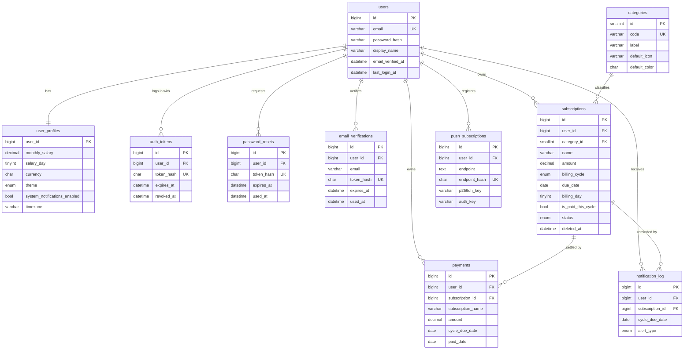
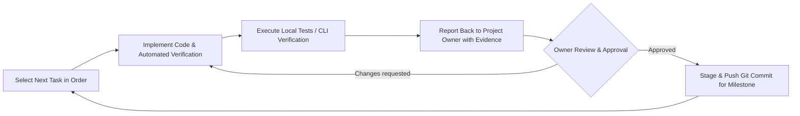

# SubTracker — Backend Developer Handoff

> Everything a backend developer needs to build the **database + REST API** for SubTracker.
> Source of truth for behaviour: [`js/store.js`](../js/store.js), [`js/utils.js`](../js/utils.js), [`js/notifications.js`](../js/notifications.js).
> Source of truth for storage: [`database/`](../database/README.md).

> [!IMPORTANT]
> **Confirmed product decisions & development rules (2026-10-15)**
> 1. **Rule 1 (Sequential Review Gate):** Each task must be done strictly in order. After each task is finished, the developer must report back with verification evidence, wait for review & approval, and commit before moving to the next task.
> 2. **Rule 2 (Phinx First):** The very first task MUST be implementing and running database migrations using the **Phinx** library (`robmorgan/phinx`).
> 3. The **"Reset to demo data"** button stays for real accounts → `POST /account/reset-demo` (§8.10).
> 4. **Email verification is required** before an account can use the API (§8.1, migration `012`).
> 5. Production hosting is **Absolute Hosting, Linux shared hosting (cPanel NVMe Palladium)** (§15).

---

## Table of contents

1. [What the app is](#1-what-the-app-is)
2. [Current state & goal](#2-current-state--goal)
3. [Target stack & project layout](#3-target-stack--project-layout)
4. [Frontend data model (what the UI expects)](#4-frontend-data-model-what-the-ui-expects)
5. [Database](#5-database)
6. [Business rules](#6-business-rules)
7. [API conventions](#7-api-conventions)
8. [API endpoints](#8-api-endpoints)
9. [Reminder notifications (Web Push + cron)](#9-reminder-notifications-web-push--cron)
10. [Security requirements](#10-security-requirements)
11. [Dates & time zones](#11-dates--time-zones)
12. [Frontend integration notes](#12-frontend-integration-notes)
13. [Decisions log & remaining open questions](#13-decisions-log--remaining-open-questions)
14. [Acceptance checklist](#14-acceptance-checklist)
15. [Production hosting: Absolute Hosting (Linux shared / cPanel)](#15-production-hosting-absolute-hosting-linux-shared--cpanel)
16. [Development protocol & phased task roadmap (Phinx first)](#16-development-protocol--phased-task-roadmap-phinx-first)

---

## 1. What the app is

**SubTracker** is a mobile-first PWA for South African users. It tracks recurring bills in **ZAR (R)**: subscriptions, rent, insurance, savings and so on. It works out what is left of the user's monthly take-home salary, and it warns the user before payments are due.

Main screens (bottom nav tabs):

| Tab | What it shows | Data needed |
|---|---|---|
| **Dashboard** | Salary, committed expenses, remaining balance, utilisation bar, paid vs due, quick presets, upcoming bills | profile, subscriptions, summary |
| **Subs** | Searchable, filterable list (All / Due / Paid / Urgent + category). Mark Paid, Renew, Edit, Delete | subscriptions |
| **Due Soon** (`calendar`) | Timeline of all subscriptions sorted by due date. Enable/test notifications | subscriptions, profile |
| **Info** | Static content | — |
| **Settings** | Theme, salary, "Reset all to Pending", JSON export/import, reset demo data | profile, backup |

Other UI: an alerts drawer (bell icon with badge), an add/edit subscription bottom sheet, a preset picker, and a salary modal.

---

## 2. Current state & goal

- **Today:** there is no backend. All data sits in the browser's `localStorage` under the key `subtracker_zar_database`, as one JSON document read and written by `StorageRepository` in `js/store.js`.
- **Goal:** replace `StorageRepository` with calls to a **PHP + MySQL REST API**, and add **user accounts** so data is per-user and synced across devices.
- **Already done:** the MySQL schema, seeds and DB conventions are in [`database/`](../database/README.md). **Use that schema as-is.** If it needs changes, add new numbered migration files (`012_...sql`) instead of editing the existing ones.
- **Not done yet:** the API itself, auth screens in the frontend, the Web Push sender, and swapping the frontend over to the API.

---

## 3. Target stack & project layout

| Concern | Choice |
|---|---|
| Language | PHP **8.2+**. Locally WAMP; in production pick 8.2/8.3 in cPanel → *Select PHP Version* |
| Framework | **Slim 4** (as referenced in `database/README.md`). Add `slim/psr7` and `php-di/php-di` |
| Migrations & Seeds | **Phinx (`robmorgan/phinx`)**. Executed via `vendor/bin/phinx migrate` (MANDATORY Task 1) |
| DB (local) | **MySQL 8.4** (WAMP: `C:\wamp64\bin\mysql\mysql8.4.7`), InnoDB, DB name `subtracker` |
| DB (production) | Whatever Absolute Hosting's cPanel server runs, **most likely MariaDB 10.6/10.11/11.x**. The code and SQL must work on **both** MySQL 8.4 and MariaDB (see §15.2) |
| DB access | PDO with prepared statements only. No ORM needed |
| Config | `vlucas/phpdotenv` (`.env`, never committed, stored **outside** `public_html`) |
| Web Push | `minishlink/web-push`. Needs PHP 8.2 and ext `curl`, `mbstring`, `openssl`. `gmp` is strongly recommended (enable it in *Select PHP Version → Extensions*) |
| Mail (verification + password reset) | `phpmailer/phpmailer` or `symfony/mailer` over **SMTP with a cPanel mailbox** (e.g. `no-reply@yourdomain.co.za`) |
| Auth | Opaque bearer tokens (see `auth_tokens` table). No sessions or cookies needed |
| Rate limiting | DB table (`rate_limits`). **Don't rely on APCu or Redis** on shared hosting |

### Suggested code layout

The same codebase is used locally and in production. Only `public/` is web-accessible.

```
sub-tracker/
├── index.html, js/, css/, sw.js ...    # existing PWA
├── database/                           # reference raw SQL (001-013)
└── api/
    ├── public/                         # ← ONLY this folder is web-reachable
    │   ├── index.php                   # Slim bootstrap; base path read from APP_BASE_PATH
    │   └── .htaccess                   # rewrite to index.php + pass Authorization header (§15.4)
    ├── db/
    │   ├── migrations/                 # Phinx migrations (Task 1)
    │   └── seeds/                      # Phinx seeds: CategorySeeder, DemoUserSeeder
    ├── phinx.php                       # Phinx configuration (reads from .env)
    ├── src/
    │   ├── Controllers/                # AuthController, ProfileController, SubscriptionController, ...
    │   ├── Services/                   # BillingService, BudgetService, PushService, MailService, DemoDataService
    │   ├── Repositories/               # SQL lives here, always scoped by user_id
    │   ├── Middleware/                 # AuthMiddleware, VerifiedEmailMiddleware, JsonBodyParser, ErrorHandler, RateLimit
    │   └── Support/                    # Validator, Clock (user-local "today"), Serializers
    ├── templates/email/                # verify-email.html/.txt, reset-password.html/.txt
    ├── bin/
    │   ├── send-reminders.php          # cron: Web Push reminders
    │   └── cleanup.php                 # cron: expired tokens, unverified accounts, old rate-limit rows
    ├── composer.json                   # with "robmorgan/phinx", "slim/slim", etc.
    └── .env.example
```

| Environment | PWA URL | API base URL |
|---|---|---|
| Local (WAMP) | `http://localhost/projects/sub-tracker/` | `http://localhost/projects/sub-tracker/api/public/v1` (or alias `/api` → `api/public`) |
| Production | `https://yourdomain.co.za/` | `https://yourdomain.co.za/api/v1` (same origin, so no CORS) |

Add to `.gitignore`: `api/vendor/` and `api/.env`.

### `.env.example`

```dotenv
APP_ENV=local                 # local | production
APP_DEBUG=true                # false in production
APP_URL=http://localhost/projects/sub-tracker          # PWA URL, used to build email links
APP_BASE_PATH=/projects/sub-tracker/api/public         # production: /api
CORS_ALLOWED_ORIGIN=          # leave empty when PWA + API share an origin
DB_HOST=127.0.0.1             # production: localhost
DB_PORT=3306
DB_NAME=subtracker            # production: cpaneluser_subtracker
DB_USER=subtracker_app        # production: cpaneluser_stapp
DB_PASS=change-me
TOKEN_TTL_DAYS=30
PASSWORD_RESET_TTL_MINUTES=60
EMAIL_VERIFY_TTL_HOURS=24
UNVERIFIED_ACCOUNT_TTL_DAYS=7
VAPID_SUBJECT=mailto:admin@yourdomain.co.za
VAPID_PUBLIC_KEY=
VAPID_PRIVATE_KEY=
MAIL_HOST=mail.yourdomain.co.za
MAIL_PORT=465                 # 465 = SSL, 587 = STARTTLS
MAIL_ENCRYPTION=ssl
MAIL_USERNAME=no-reply@yourdomain.co.za
MAIL_PASSWORD=change-me
MAIL_FROM=no-reply@yourdomain.co.za
MAIL_FROM_NAME=SubTracker
```

### Required PDO setup

```php
$pdo = new PDO("mysql:host=$h;port=$p;dbname=$db;charset=utf8mb4", $u, $pw, [
    PDO::ATTR_ERRMODE            => PDO::ERRMODE_EXCEPTION,
    PDO::ATTR_DEFAULT_FETCH_MODE => PDO::FETCH_ASSOC,
    PDO::ATTR_EMULATE_PREPARES   => false,
]);
$pdo->exec("SET time_zone = '+00:00'");   // audit timestamps are UTC — mandatory (offset form works without tz tables)
date_default_timezone_set('UTC');          // PHP side too; user-local dates use the profile timezone explicitly
```

---

## 4. Frontend data model (what the UI expects)

The frontend works on **one state object** with three keys. The API's JSON must use the same **camelCase** field names so the frontend swap stays small.

```jsonc
{
  "profile": {
    "monthlySalary": 28500.00,
    "salaryDay": 25,
    "currency": "ZAR",
    "currencySymbol": "R",
    "systemNotificationsEnabled": false,
    "theme": "dark"                       // "dark" | "light"
  },
  "subscriptions": [
    {
      "id": "sub_demo_1",                 // backend: integer, frontend treats it as opaque
      "name": "Showmax Entertainment",
      "category": "Entertainment",        // category CODE, see §5 categories
      "amount": 99.00,                    // per billing cycle, ZAR
      "billingCycle": "monthly",          // "weekly" | "monthly" | "yearly"
      "dueDate": "2026-10-17",            // NEXT due date, YYYY-MM-DD
      "startDate": "2026-01-01",
      "icon": "fa-tv",                    // Font Awesome class
      "color": "#0084f7",
      "isPaidThisCycle": false,
      "notes": "Standard plan"
    }
  ],
  "paymentHistory": [
    {
      "id": "pay_demo_1",
      "subscriptionId": "sub_demo_4",
      "name": "Spotify Premium",          // snapshot of the subscription name
      "amount": 64.99,                    // snapshot of the amount
      "paidDate": "2026-10-15"
    }
  ]
}
```

### Field mapping: API JSON ↔ DB column

**Profile** (`user_profiles`)

| JSON | Column | Notes |
|---|---|---|
| `monthlySalary` | `monthly_salary` DECIMAL(12,2) | ≥ 0 |
| `salaryDay` | `salary_day` TINYINT NULL | 1–31. Stored, but no UI edits it yet |
| `currency` | `currency` CHAR(3) | `ZAR` (fixed for now) |
| `currencySymbol` | `currency_symbol` | `R` |
| `systemNotificationsEnabled` | `system_notifications_enabled` | bool |
| `theme` | `theme` ENUM | `dark` / `light` |
| `timezone` *(new)* | `timezone` | IANA, default `Africa/Johannesburg` |

**Subscription** (`subscriptions` + `categories`)

| JSON | Column | Notes |
|---|---|---|
| `id` | `id` | BIGINT |
| `name` | `name` | 1–100 chars, trimmed |
| `category` | `categories.code` via `category_id` | Frontend sends and receives the **code** string |
| `categoryLabel` *(new, read-only)* | `categories.label` | Optional extra |
| `amount` | `amount` DECIMAL(10,2) | > 0 |
| `billingCycle` | `billing_cycle` | ENUM |
| `dueDate` | `due_date` DATE | user-local date |
| `billingDay` *(new, read-only)* | `billing_day` | Server-derived, see §6.4 |
| `startDate` | `start_date` DATE NULL | |
| `icon` | `icon` | |
| `color` | `color` CHAR(7) | `#RRGGBB` |
| `notes` | `notes` VARCHAR(255) NULL | |
| `isPaidThisCycle` | `is_paid_this_cycle` | **read-only** in create/update; changed only by the pay endpoints |
| `status` *(new)* | `status` ENUM | `active` / `paused`. The frontend already skips `paused` subs in alerts |
| `createdAt` / `updatedAt` | `created_at` / `updated_at` | ISO-8601 UTC (`2026-10-15T18:32:41Z`) |
| — | `deleted_at` | Never exposed. Soft-deleted rows are never returned |

**Payment** (`payments`)

| JSON | Column |
|---|---|
| `id` | `id` |
| `subscriptionId` | `subscription_id` (nullable) |
| `name` | `subscription_name` (snapshot) |
| `amount` | `amount` (snapshot) |
| `paidDate` | `paid_date` |
| `cycleDueDate` *(new)* | `cycle_due_date` |
| `createdAt` | `created_at` |

---

## 5. Database

Full DDL is in `database/schema/001…011`, plus the **two new migrations below (012, 013)**. Local install instructions are in [`database/README.md`](../database/README.md):

```powershell
& C:\wamp64\bin\mysql\mysql8.4.7\bin\mysql.exe -u root -p -h 127.0.0.1 -P 3306 < database/install.sql
```

> [!WARNING]
> `install.sql` **will not work as-is on Absolute Hosting**. It uses `SOURCE`, `CREATE DATABASE`, `USE subtracker` and a MySQL-only collation. Follow the production install in **§15.3**.

Dev login created by the seed: **`demo@subtracker.local` / `Demo@1234`** (already email-verified). It has the same data as the PWA's demo dataset. **Never run `002_seed_demo_user.sql` in production.**

### ERD



`rate_limits` (013) stands alone, with no foreign keys.

### Tables at a glance

| Table | Purpose |
|---|---|
| `users` | Accounts. Email is unique and case-insensitive. Stores `password_hash()` output. `email_verified_at IS NULL` = not verified yet |
| `user_profiles` | 1:1 with users. **Insert it in the same transaction as the user on registration** |
| `auth_tokens` | One row per logged-in device. Stores **only** the SHA-256 of the token |
| `password_resets` | Single-use reset tokens (SHA-256 only) |
| `email_verifications` **(new, 012)** | Single-use email verification tokens (SHA-256 only), 24 h expiry |
| `rate_limits` **(new, 013)** | Fixed-window counters for login, registration, resend-verification, forgot-password, push test, reset-demo |
| `categories` | System lookup with 14 seeded rows. Users can't edit it |
| `subscriptions` | Recurring bills, soft delete via `deleted_at` |
| `payments` | History ledger. Name and amount are **snapshots** |
| `push_subscriptions` | Web Push endpoints per device |
| `notification_log` | Deduplicates reminders, so the cron is idempotent |
| `vw_user_budget_summary` | View with the dashboard totals (same math as the frontend) |

### New migration `database/schema/012_create_email_verifications.sql`

```sql
-- SubTracker | 012 - email_verifications
-- Single-use email verification tokens. Only hash('sha256', token) is stored.
-- `email` records which address was verified (lets you add "change email" later).
-- No USE statement: select the target DB first (cPanel DB names are prefixed).

CREATE TABLE email_verifications (
  id         BIGINT UNSIGNED NOT NULL AUTO_INCREMENT,
  user_id    BIGINT UNSIGNED NOT NULL,
  email      VARCHAR(191)    NOT NULL,
  token_hash CHAR(64)        NOT NULL COMMENT 'SHA-256 hex of the plain token',
  expires_at DATETIME        NOT NULL,
  used_at    DATETIME        NULL,
  created_at DATETIME        NOT NULL DEFAULT CURRENT_TIMESTAMP,
  PRIMARY KEY (id),
  UNIQUE KEY uq_email_verifications_hash (token_hash),
  KEY idx_email_verifications_user (user_id, created_at),
  CONSTRAINT fk_email_verifications_user
    FOREIGN KEY (user_id) REFERENCES users (id) ON DELETE CASCADE
) ENGINE=InnoDB COMMENT='Email verification tokens (hashed)';
```

### New migration `database/schema/013_create_rate_limits.sql`

```sql
-- SubTracker | 013 - rate_limits
-- Fixed-window counters (shared hosting has no reliable APCu/Redis).
-- bucket examples: 'login:ip:41.13.0.1', 'login:email:<sha256(email)>', 'verify-resend:user:7'
-- Never store raw emails here; hash them.

CREATE TABLE rate_limits (
  bucket       VARCHAR(100) NOT NULL,
  window_start DATETIME     NOT NULL COMMENT 'UTC start of the fixed window',
  hits         INT UNSIGNED NOT NULL DEFAULT 0,
  PRIMARY KEY (bucket, window_start),
  KEY idx_rate_limits_window (window_start)
) ENGINE=InnoDB COMMENT='API rate-limit counters';
```

Usage (works on MySQL and MariaDB):

```sql
INSERT INTO rate_limits (bucket, window_start, hits) VALUES (:bucket, :windowStart, 1)
ON DUPLICATE KEY UPDATE hits = hits + 1;
SELECT hits FROM rate_limits WHERE bucket = :bucket AND window_start = :windowStart;  -- > limit → 429
```

`bin/cleanup.php` deletes rows older than 1 day.

### Categories (seeded, `code` = what the frontend sends)

`Entertainment`, `Music`, `Internet`, `Telco`, `Fitness`, `Health`, `Cloud`, `Software`, `Insurance`, `Housing`, `Food`, `Family`, `Savings`, `Other`

### Conventions (must follow)

- Every query on user-owned data includes `WHERE user_id = :authUserId`. **Never trust a `userId` sent by the client.**
- All "live" queries on subscriptions include `deleted_at IS NULL`.
- Money is `DECIMAL`, never `FLOAT`. Do the maths in SQL, or round to 2 dp in PHP.
- Audit timestamps are **UTC** `DATETIME`. Business dates (`due_date`, `paid_date`, `cycle_due_date`) are **user-local** `DATE` (see §11).
- Account deletion (POPIA): `DELETE FROM users WHERE id = ?` cascades to everything.
- **Portable SQL only** (must run on MySQL 8.4 *and* MariaDB). Avoid `INSERT ... AS alias ON DUPLICATE KEY` row aliases, `JSON_TABLE`, `CONVERT_TZ` with named zones, and `utf8mb4_0900_*` collations in new files. Details in §15.2.

---

## 6. Business rules

These must match what the frontend does today, so numbers don't change after the migration.

### 6.1 Budget math (dashboard)

| Value | Formula |
|---|---|
| Monthly-normalised amount | `weekly → amount × 4.333`, `yearly → amount ÷ 12`, `monthly → amount` |
| `totalCommittedMonthly` | Σ normalised amount over live, active subscriptions |
| `totalPaidThisCycle` | Σ **raw** `amount` where `isPaidThisCycle = true` |
| `totalDueThisCycle` | Σ **raw** `amount` where `isPaidThisCycle = false` |
| `remainingBalance` | `monthlySalary − totalCommittedMonthly` (can be negative) |
| `budgetUtilizationPercent` | `salary <= 0 ? 0 : min(round(committed / salary × 100, 1), 100)` |
| Status colour (UI only) | `> 60` red, `> 35` amber, else green |

`vw_user_budget_summary` already does this (minus the utilisation %).

> Paid/due use raw cycle amounts while committed uses normalised amounts. That is how the current frontend works. Keep it that way for parity.

### 6.2 Urgency / alert classification

`days = dueDate − userLocalToday` (whole days).

| Condition | Label (UI) | Urgency type | In alerts drawer? | Alert `type` | `notification_log.alert_type` |
|---|---|---|---|---|---|
| paid | `Paid` | `paid` | no | — | — |
| `days < 0` | `Overdue by Nd` | `overdue` | yes | `overdue` | `overdue` |
| `days = 0` | `Due Today` | `today` | yes | `today` | `due_today` |
| `days = 1` | `Due Tomorrow` | `urgent` | yes | `urgent` | `upcoming` |
| `2 ≤ days ≤ 3` | `Due in N days` | `urgent` | yes | `urgent` | `upcoming` |
| `4 ≤ days ≤ 7` | `Due in N days` | `soon` | no | — | — |
| `days > 7` | `In N days` | `normal` | no | — | — |

Paused subscriptions never produce alerts. Alerts are sorted by `days` ascending.

### 6.3 List filter & sort (Subs tab)

| Filter | Rule |
|---|---|
| `all` | everything live |
| `due` | `isPaidThisCycle = false` |
| `paid` | `isPaidThisCycle = true` |
| `urgent` | unpaid **and** `dueDate <= today + 3` (includes overdue) |
| `category` | exact category code |
| `q` | case-insensitive substring of `name`, category code, or `notes` |

Default sort: **unpaid first, then `due_date` ascending** (`ORDER BY is_paid_this_cycle ASC, due_date ASC, id ASC`).

### 6.4 Paid-state & cycle actions (run each one in one transaction)

| Action | DB writes |
|---|---|
| **Create** | Insert with `is_paid_this_cycle = 0` and `billing_day = DAY(due_date)` |
| **Update** | If `dueDate` changed, set `billing_day = DAY(new due_date)`. Never touch `is_paid_this_cycle` |
| **Mark Paid** | If already paid, return the current state with no new row (idempotent). Otherwise set `is_paid_this_cycle = 1` and insert a `payments` row with snapshot `name` and `amount`, `cycle_due_date = due_date`, `paid_date = userLocalToday` |
| **Un-mark Paid** | If not paid, no-op. Otherwise set the flag to 0 and delete the **latest** `payments` row for `(subscription_id, cycle_due_date = current due_date)` |
| **Renew Next Cycle** | Advance `due_date` (algorithm below) and set `is_paid_this_cycle = 0`. The UI only shows the Renew button on paid subs, but the API should accept it in any state |
| **Reset all to Pending** | `is_paid_this_cycle = 0` for all of the user's live subscriptions. History is untouched |
| **Delete** | Soft delete with `deleted_at = UTC_TIMESTAMP()`. Payment history keeps its link |

SQL for Mark/Un-mark is in [`database/README.md`](../database/README.md#paid-state-rules-api-contract). Use `SELECT ... FOR UPDATE` on the subscription row first so a double tap can't insert two payments.

#### Renew algorithm (server is the source of truth)

```php
function advanceDueDate(DateTimeImmutable $due, string $cycle, ?int $billingDay): DateTimeImmutable {
    if ($cycle === 'weekly') return $due->modify('+7 days');

    $anchor = $billingDay ?? (int) $due->format('j');
    $first  = $due->modify('first day of this month')
                  ->modify($cycle === 'yearly' ? '+1 year' : '+1 month');
    $day    = min($anchor, (int) $first->format('t'));     // clamp to month length
    return $first->setDate((int) $first->format('Y'), (int) $first->format('n'), $day);
}
// monthly, billing_day 31: 2026-01-31 → 2026-02-28 → 2026-03-31
// yearly,  billing_day 29: 2028-02-29 → 2029-02-28 → 2030-02-28
```

> **Don't copy `SubUtils.advanceDueDate`.** It uses JS `setMonth`, which overflows (31 Jan → 3 Mar). It also calls `toISOString()`, which moves the date back one day in UTC+2. See §11.

### 6.5 Validation rules

| Field | Rule | Error example |
|---|---|---|
| `name` | required, trimmed, 1–100 chars | `Please enter a subscription name` |
| `amount` | number, `> 0`, `≤ 99 999 999.99`, max 2 dp | `Please enter a valid amount in Rands` |
| `billingCycle` | `weekly` \| `monthly` \| `yearly` (default `monthly`) | |
| `dueDate` | required, valid `YYYY-MM-DD` | |
| `startDate` | optional, valid date | |
| `category` | must be an existing `categories.code` (default `Other`) | |
| `icon` | `^fa-[a-z0-9-]{1,37}$` (whitelist optional, see list in `index.html` lines ~960–984) | |
| `color` | `^#[0-9A-Fa-f]{6}$` (default `#6366f1`) | |
| `notes` | optional, ≤ 255 chars | |
| `status` | `active` \| `paused` | |
| `monthlySalary` | number `≥ 0`, ≤ 9 999 999 999.99 | `Please enter a valid salary amount` |
| `salaryDay` | null or 1–31 | |
| `theme` | `dark` \| `light` | |
| `timezone` | in `DateTimeZone::listIdentifiers()` | |
| `email` | valid, ≤ 191 chars, stored lower-cased and trimmed | |
| `password` | ≥ 8 chars (suggest: at least 1 letter + 1 digit) | |

Ignore unknown fields. Silently ignore read-only fields (`id`, `isPaidThisCycle`, `billingDay`, `createdAt`, …) in request bodies. The edit form sends the whole object back.

---

## 7. API conventions

- **Base path:** `/api/v1`
- **Format:** JSON in and out (`Content-Type: application/json; charset=utf-8`). Field names are **camelCase**.
- **Auth:** `Authorization: Bearer <token>` on every endpoint except register, login, verify-email, resend-verification, forgot/reset password, and the VAPID public key.
- **Verified email required:** every authenticated endpoint also requires `users.email_verified_at IS NOT NULL` (`VerifiedEmailMiddleware`). Unverified users can't get a token in the first place (§8.1), so this is a second line of defence.
- **IDs:** integers.
- **Money:** JSON numbers rounded to 2 dp (e.g. `99.0`, `64.99`). The frontend formats them as `R 1 250,50`.
- **Business dates:** `"YYYY-MM-DD"`. **Timestamps:** ISO-8601 UTC (`"2026-10-15T18:32:41Z"`).
- **Booleans:** real JSON booleans, not `0`/`1`.
- **Methods:** `GET`, `POST`, `PUT`, `PATCH`, `DELETE`. If Imunify360 / ModSecurity on the host blocks `PUT`/`PATCH`/`DELETE` (§15.6), also accept `POST` with the header `X-HTTP-Method-Override` (Slim's `MethodOverrideMiddleware`).

### Response envelope

```jsonc
// 200 / 201
{ "data": { ... } }                     // or { "data": [ ... ], "meta": { "page": 1, "perPage": 50, "total": 120 } }

// 4xx / 5xx
{
  "error": {
    "code": "VALIDATION_FAILED",        // machine-readable
    "message": "Some fields are invalid.",
    "fields": { "amount": "Please enter a valid amount in Rands" }   // only for 422
  }
}
```

### Status codes

| Code | When |
|---|---|
| 200 | OK |
| 201 | Created (return the created resource) |
| 202 | Accepted: email queued/sent (register, resend-verification, forgot-password), push test |
| 204 | Deleted / no content |
| 400 | Malformed JSON |
| 401 | `UNAUTHENTICATED`: missing, invalid, expired or revoked token. `INVALID_CREDENTIALS` on login |
| 403 | `EMAIL_NOT_VERIFIED`: correct password but email not verified yet (login), or token belongs to an unverified user |
| 404 | `NOT_FOUND`: also use this for **other users' resources** (never 403, so IDs can't be probed) |
| 409 | `CONFLICT`: e.g. `EMAIL_TAKEN` |
| 410 | `TOKEN_EXPIRED`: verification or reset link expired or already used |
| 422 | `VALIDATION_FAILED` |
| 429 | `RATE_LIMITED` (include a `Retry-After` header) |
| 500 | `SERVER_ERROR` (never leak stack traces when `APP_ENV=production`) |

---

## 8. API endpoints

### 8.0 Summary

| Method | Path | Auth | Purpose | Replaces (frontend) |
|---|---|---|---|---|
| POST | `/auth/register` | – | Create account + profile, send verification email | *(new)* |
| POST | `/auth/verify-email` | – | Confirm email with token, activate account & return bearer token | *(new)* |
| POST | `/auth/resend-verification` | – | Request a fresh email verification link | *(new)* |
| POST | `/auth/login` | – | Return bearer token (requires verified email) | *(new)* |
| POST | `/auth/logout` | ✔ | Revoke current token | *(new)* |
| GET | `/auth/me` | ✔ | Current user | *(new)* |
| POST | `/auth/forgot-password` | – | Email a reset link | *(new)* |
| POST | `/auth/reset-password` | – | Set new password with token | *(new)* |
| PUT | `/auth/password` | ✔ | Change password (logged in) | *(new)* |
| DELETE | `/auth/account` | ✔ | Delete account and all data (POPIA) | *(new)* |
| POST | `/account/reset-demo` | ✔ | Overwrite user data with SA demo dataset | `resetToDefaults()` |
| GET | `/state` | ✔ | **Whole state in one call** `{profile, subscriptions, paymentHistory}` | `StorageRepository.load()` / `init()` |
| GET | `/profile` | ✔ | Get profile | — |
| PATCH | `/profile` | ✔ | Update salary / theme / notifications / timezone / salaryDay | `saveSalary`, `setTheme`, `requestNotificationPermission` |
| GET | `/categories` | ✔ | Category lookup | hard-coded `<select>` |
| GET | `/subscriptions` | ✔ | List (filter, search, sort) | `subscriptions`, `filteredSubscriptions` |
| POST | `/subscriptions` | ✔ | Create | `saveSubscriptionForm` (new) |
| GET | `/subscriptions/{id}` | ✔ | Get one | — |
| PUT | `/subscriptions/{id}` | ✔ | Full update | `saveSubscriptionForm` (edit) |
| PATCH | `/subscriptions/{id}` | ✔ | Partial update (e.g. `status`) | — |
| DELETE | `/subscriptions/{id}` | ✔ | Soft delete | `executeDelete` |
| POST | `/subscriptions/{id}/payment` | ✔ | Mark paid | `togglePaidStatus` (→ paid) |
| DELETE | `/subscriptions/{id}/payment` | ✔ | Un-mark paid | `togglePaidStatus` (→ pending) |
| POST | `/subscriptions/{id}/renew` | ✔ | Advance to next cycle | `renewNextCycle` |
| POST | `/subscriptions/reset-paid` | ✔ | All → pending | `resetAllPaidStatus` |
| GET | `/payments` | ✔ | Payment history | `paymentHistory` |
| GET | `/dashboard/summary` | ✔ | Budget totals | store getters (`totalCommittedExpenses`, …) |
| GET | `/alerts` | ✔ | Upcoming/overdue alerts | `upcomingAlerts` |
| GET | `/backup` | ✔ | Export JSON (same shape as today's file) | `exportData` |
| POST | `/backup` | ✔ | Import / restore (replaces data) | `handleImportFile` |
| GET | `/push/vapid-public-key` | – | Key for `pushManager.subscribe()` | *(new)* |
| POST | `/push/subscriptions` | ✔ | Register this device | *(new)* |
| DELETE | `/push/subscriptions` | ✔ | Unregister this device | *(new)* |
| POST | `/push/test` | ✔ | Send a test push to the user's devices | `testNotification` |

> Calendar tab, filters, search, theme toggle, and PWA install stay client-side. `/subscriptions` supports server-side filters, but the frontend can keep filtering in memory after `GET /state`.

---

### 8.1 Auth

#### `POST /auth/register`

```json
{
  "email": "thabo@example.co.za",
  "password": "S3cure!pass",
  "displayName": "Thabo",
  "timezone": "Africa/Johannesburg",
  "deviceName": "Pixel 8"
}
```

In one transaction:
1. Validate inputs (email format, password complexity ≥ 8 chars).
2. Insert `users` with `email_verified_at = NULL` and bcrypt hash.
3. Insert default `user_profiles` row linked to `users.id`.
4. Generate 32-byte crypto-random token (`$plain = bin2hex(random_bytes(32))`).
5. Insert into `email_verifications` with `token_hash = hash('sha256', $plain)` and `expires_at = UTC_TIMESTAMP() + INTERVAL 24 HOUR`.
6. Dispatch verification email via SMTP (Absolute Hosting cPanel mailbox) with link: `https://yourdomain.co.za/#verify?token=<plain>`.
7. Record rate-limit hit against IP (`rate_limits` table: max 5 registrations/hour per IP).

**202 Accepted** (no active token issued yet since email verification is mandatory):

```json
{
  "data": {
    "message": "Account created. Please check your email to verify your account before logging in.",
    "email": "thabo@example.co.za",
    "requiresVerification": true
  }
}
```

Errors: `409 EMAIL_TAKEN`, `422 VALIDATION_FAILED`, `429 RATE_LIMITED`.

#### `POST /auth/verify-email`

Validates token, marks account verified, and issues the first session bearer token so the user is immediately logged in.

```json
{
  "token": "4f1c...e9a2",
  "deviceName": "Pixel 8"
}
```

Steps:
1. Lookup row in `email_verifications` where `token_hash = hash('sha256', $token)`.
2. Check `used_at IS NULL` and `expires_at > UTC_TIMESTAMP()`. If expired/used → `410 TOKEN_EXPIRED`.
3. In one transaction:
   - Set `used_at = UTC_TIMESTAMP()`.
   - Update `users` set `email_verified_at = UTC_TIMESTAMP()` where `id = :userId`.
   - Issue new bearer token (insert into `auth_tokens`).

**200 OK**

```json
{
  "data": {
    "token": "a8f3...12bc",
    "expiresAt": "2026-11-14T18:32:41Z",
    "user": {
      "id": 7,
      "email": "thabo@example.co.za",
      "displayName": "Thabo",
      "emailVerified": true,
      "createdAt": "2026-10-15T18:32:41Z"
    }
  }
}
```

#### `POST /auth/resend-verification`

```json
{
  "email": "thabo@example.co.za"
}
```

- Rate-limit: max 3 per 15 minutes per email/IP.
- Response: always **202 Accepted** `{ "data": { "message": "If the account exists and is unverified, a verification link has been sent." } }` (prevents user enumeration).
- Invalidate previous unused verification tokens for that user, generate a new token, and resend email.

#### `POST /auth/login`

```json
{
  "email": "demo@subtracker.local",
  "password": "Demo@1234",
  "deviceName": "Chrome on Windows"
}
```

Steps:
1. Lookup user by email. If not found or `password_verify()` fails → `401 INVALID_CREDENTIALS` (record rate limit hit: max 5 failures per 5 minutes per IP/email).
2. **Email verification check:** If `email_verified_at IS NULL` → return **403 EMAIL_NOT_VERIFIED**:
   ```json
   {
     "error": {
       "code": "EMAIL_NOT_VERIFIED",
       "message": "Your email address has not been verified. Please check your inbox or request a new verification link."
     }
   }
   ```
3. Issue opaque bearer token:
   ```php
   $plain = bin2hex(random_bytes(32)); // 64 hex chars
   $hash  = hash('sha256', $plain);
   // insert into auth_tokens: token_hash, user_id, expires_at = now + 30 days
   ```
4. Update `users.last_login_at = UTC_TIMESTAMP()`.

**200 OK**

```json
{
  "data": {
    "token": "4f1c...e9a2",
    "expiresAt": "2026-11-14T18:32:41Z",
    "user": {
      "id": 7,
      "email": "demo@subtracker.local",
      "displayName": "Demo User",
      "emailVerified": true,
      "createdAt": "2026-10-15T18:32:41Z"
    }
  }
}
```

**Auth & VerifiedEmail Middleware:**
1. `AuthMiddleware`: look up `hash('sha256', $bearer)` in `auth_tokens` where `revoked_at IS NULL AND expires_at > UTC_TIMESTAMP()`. Attach `user` to request attributes. Update `last_used_at` (throttled to at most once per 5 min).
2. `VerifiedEmailMiddleware`: check `$user['email_verified_at'] !== null`. If null, abort with `403 EMAIL_NOT_VERIFIED`.

#### `POST /auth/logout` → **204**
Sets `revoked_at = UTC_TIMESTAMP()` on the current token. Also deletes the device's push subscription if the client passes `{ "pushEndpoint": "..." }`.

#### `GET /auth/me` → **200** `{ "data": { "id", "email", "displayName", "emailVerified", "createdAt" } }`

#### `POST /auth/forgot-password`
`{ "email": "..." }` → **always 202** (don't reveal whether the account exists).
If user exists: store `hash('sha256', $plain)` in `password_resets` with `expires_at = now + 60 min`, then email `APP_URL/#reset?token=<plain>`.

#### `POST /auth/reset-password`
`{ "token": "...", "password": "..." }` → **204**.
Token must be unused and unexpired. Set `used_at`, update `password_hash`, and **revoke all of the user's `auth_tokens`**.

#### `PUT /auth/password`
`{ "currentPassword": "...", "newPassword": "..." }` → **204**. Revoke all other tokens.

#### `DELETE /auth/account`
`{ "password": "..." }` → **204**. Verify password, then `DELETE FROM users WHERE id = :uid` (cascades to all user data).

---

### 8.2 State (bootstrap: easiest drop-in for `StorageRepository.load()`)

#### `GET /state` → **200**

```json
{
  "data": {
    "profile": {
      "monthlySalary": 28500.0, "salaryDay": 25, "currency": "ZAR", "currencySymbol": "R",
      "systemNotificationsEnabled": false, "theme": "dark", "timezone": "Africa/Johannesburg"
    },
    "subscriptions": [ /* live subs, default sort, see 8.5 shape */ ],
    "paymentHistory": [ /* latest first, last 12 months or max 500 rows */ ],
    "today": "2026-10-15"
  }
}
```

`today` is the user-local date. The frontend should use it instead of computing "today" in UTC.

---

### 8.3 Profile

#### `GET /profile` → `{ "data": { ...profile } }`

#### `PATCH /profile`

```json
{ "monthlySalary": 30000 }
{ "theme": "light" }
{ "systemNotificationsEnabled": true }
{ "salaryDay": 25, "timezone": "Africa/Johannesburg" }
```

→ **200** with the full updated profile. `currency` and `currencySymbol` are read-only for now.

---

### 8.4 Categories

#### `GET /categories` → **200** (cacheable, `Cache-Control: max-age=86400`)

```json
{ "data": [ { "code": "Entertainment", "label": "Entertainment", "defaultIcon": "fa-tv", "defaultColor": "#0084f7", "sortOrder": 1 }, ... ] }
```

---

### 8.5 Subscriptions

**Subscription resource**

```json
{
  "id": 12,
  "name": "Showmax Entertainment",
  "category": "Entertainment",
  "categoryLabel": "Entertainment",
  "amount": 99.0,
  "billingCycle": "monthly",
  "dueDate": "2026-10-17",
  "billingDay": 17,
  "startDate": "2026-01-01",
  "icon": "fa-tv",
  "color": "#0084f7",
  "notes": "Standard plan",
  "isPaidThisCycle": false,
  "status": "active",
  "createdAt": "2026-10-15T18:32:41Z",
  "updatedAt": "2026-10-15T18:32:41Z"
}
```

#### `GET /subscriptions`

Query params (all optional): `filter=all|due|paid|urgent`, `category=<code>`, `q=<text>`, `status=active|paused|all` (default `all`). Rules are in §6.3.
**200** `{ "data": [ ...subscriptions ] }`. No pagination is needed (one user's list is small), but cap the result at 1000 rows.

#### `POST /subscriptions`

```json
{
  "name": "Netflix", "category": "Entertainment", "amount": 159, "billingCycle": "monthly",
  "dueDate": "2026-10-28", "startDate": "2026-10-15", "icon": "fa-film", "color": "#e50914",
  "notes": "Standard plan"
}
```

**201** `{ "data": { ...subscription } }`

#### `GET /subscriptions/{id}` → **200** / **404**

#### `PUT /subscriptions/{id}`
Same body as POST (all editable fields) → **200**. Recompute `billing_day` if `dueDate` changed.

#### `PATCH /subscriptions/{id}`
Any subset, e.g. `{ "status": "paused" }` → **200**.

#### `DELETE /subscriptions/{id}` → **204** (soft delete)

#### `POST /subscriptions/{id}/payment` (Mark Paid)
Body optional: `{ "paidDate": "2026-10-15" }` (defaults to user-local today and must not be in the future).
**201** if a payment was created, **200** if it was already paid:

```json
{
  "data": {
    "subscription": { "id": 12, "isPaidThisCycle": true, "...": "..." },
    "payment": { "id": 88, "subscriptionId": 12, "name": "Showmax Entertainment", "amount": 99.0, "cycleDueDate": "2026-10-17", "paidDate": "2026-10-15", "createdAt": "2026-10-15T18:40:00Z" }
  }
}
```

#### `DELETE /subscriptions/{id}/payment` (Un-mark Paid)
**200** `{ "data": { "subscription": { ... }, "removedPaymentId": 88 } }` (`removedPaymentId` is `null` if nothing was removed).

#### `POST /subscriptions/{id}/renew`
**200** `{ "data": { ...subscription with new dueDate, isPaidThisCycle: false } }`

#### `POST /subscriptions/reset-paid`
**200** `{ "data": { "updated": 5 } }`

---

### 8.6 Payments

#### `GET /payments`
Query: `from=YYYY-MM-DD`, `to=YYYY-MM-DD`, `subscriptionId=<id>`, `page=1`, `perPage=50` (max 200). Sorted by `paid_date DESC, id DESC`.

```json
{
  "data": [ { "id": 88, "subscriptionId": 12, "name": "Showmax Entertainment", "amount": 99.0, "cycleDueDate": "2026-10-17", "paidDate": "2026-10-15", "createdAt": "2026-10-15T18:40:00Z" } ],
  "meta": { "page": 1, "perPage": 50, "total": 1, "totalAmount": 99.0 }
}
```

> Payment history is stored on the frontend today but **not shown anywhere in the UI yet**. The endpoint is still needed for backup/export and for a future history screen.

---

### 8.7 Dashboard & alerts

#### `GET /dashboard/summary` (from `vw_user_budget_summary` plus utilisation %)

```json
{
  "data": {
    "monthlySalary": 28500.0,
    "activeSubscriptions": 5,
    "totalCommittedMonthly": 2261.99,
    "totalPaidThisCycle": 64.99,
    "totalDueThisCycle": 2197.0,
    "remainingBalance": 26238.01,
    "budgetUtilizationPercent": 7.9,
    "alertCount": 2
  }
}
```

#### `GET /alerts` (rules in §6.2, computed with the user-local today)

```json
{
  "data": [
    { "id": "alert_15_soon", "subscriptionId": 15, "subName": "Virgin Active Classic", "amount": 450.0, "dueDate": "2026-10-16", "days": 1, "type": "urgent" }
  ]
}
```

The `id` format is `alert_{subId}_{overdue|today|soon}`, the same as the frontend. Titles and messages stay in the frontend (it formats ZAR and dates).

---

### 8.8 Backup (export / import)

#### `GET /backup`
Returns **exactly** the current frontend export shape, so old and new files are interchangeable. Send it with `Content-Disposition: attachment; filename="subtracker_backup_2026-10-15.json"`:

```json
{ "profile": { ... }, "subscriptions": [ ... ], "paymentHistory": [ ... ] }
```

#### `POST /backup` (restore, **replaces** the user's data)

Body: the JSON file content (max **1 MB**, ≤ 1000 subscriptions, ≤ 10 000 payments). It must contain `profile` (object) and `subscriptions` (array). `paymentHistory` is optional.

Steps, in one transaction:
1. Validate every subscription with the §6.5 rules. Any failure → **422** with the index, e.g. `fields: { "subscriptions[3].amount": "..." }`.
2. Update the profile (salary, salaryDay, theme, notifications only).
3. Hard-delete the user's existing `payments`, then their `subscriptions`.
4. Insert the subscriptions. Map the legacy string IDs (`"sub_1729...abc"`) to the new integer IDs in a lookup table. Map unknown category codes to `Other`. Set `billing_day = DAY(due_date)`.
5. Insert payments, re-linking `subscriptionId` through the lookup (`NULL` if not found). Set `cycle_due_date` to `paidDate` when it is missing from old files.

**200** `{ "data": { "subscriptions": 12, "payments": 30 } }`

> This endpoint also handles **migrating a device's existing localStorage data** on the user's first login. The frontend can offer "Upload my local data" and POST the old `subtracker_zar_database` object here.

---

### 8.9 Push

#### `GET /push/vapid-public-key` → `{ "data": { "publicKey": "BEl6..." } }`

#### `POST /push/subscriptions`
Body is the browser's `PushSubscription.toJSON()` plus optional metadata:

```json
{ "endpoint": "https://fcm.googleapis.com/fcm/send/...", "keys": { "p256dh": "BNc...", "auth": "tBH..." }, "contentEncoding": "aes128gcm" }
```

Upsert by endpoint hash. If the row belongs to another user (same browser, different account), **re-assign it to the current user**:

```sql
INSERT INTO push_subscriptions (user_id, endpoint, p256dh_key, auth_key, content_encoding, user_agent)
VALUES (:uid, :endpoint, :p256dh, :auth, :enc, :ua)
ON DUPLICATE KEY UPDATE user_id = VALUES(user_id), p256dh_key = VALUES(p256dh_key),
  auth_key = VALUES(auth_key), content_encoding = VALUES(content_encoding),
  user_agent = VALUES(user_agent), failure_count = 0;
```

→ **201**. Also set `user_profiles.system_notifications_enabled = 1`.

#### `DELETE /push/subscriptions`
`{ "endpoint": "..." }` → **204**. Only deletes rows belonging to the current user.

#### `POST /push/test` → **202**
Sends `"SubTracker Test Alert"` to all of the user's devices. Rate-limit it to 5 per hour.

---

### 8.10 Account / Demo Reset

#### `POST /account/reset-demo`

Replaces the calling user's profile, subscriptions, and payment history with the standard South African demo dataset (`DEFAULT_SAMPLE_DATA` from `js/store.js`).
This backs the existing UI button in Settings: **"Reset to Demo Data"**.

- **Auth required:** Yes (bearer token).
- **Rate-limit:** max 3 resets per hour per user.

In one transaction:
1. Soft-delete or hard-delete all existing payments and subscriptions for this user:
   ```sql
   DELETE FROM payments WHERE user_id = :uid;
   DELETE FROM subscriptions WHERE user_id = :uid;
   ```
2. Reset `user_profiles` to default values:
   - `monthly_salary = 28500.00`
   - `salary_day = 25`
   - `currency = 'ZAR'`, `currency_symbol = 'R'`
   - `theme = 'dark'`
3. Insert the 5 demo subscriptions with due dates relative to the user's local today:
   - Showmax Entertainment (R99.00, due in +2 days)
   - DSTV Stream Compact (R799.00, due in +5 days)
   - Vodacom Home Fibre (R849.00, due in +18 days)
   - Spotify Premium (R64.99, due -1 day, `is_paid_this_cycle = 1`)
   - Virgin Active Classic (R450.00, due +1 day)
4. Insert 1 payment ledger entry for Spotify Premium with `paid_date = userLocalToday`.

**200 OK**

```json
{
  "data": {
    "message": "Account reset to default South African demo subscriptions.",
    "subscriptions": 5,
    "payments": 1
  }
}
```

---

## 9. Reminder notifications (Web Push + cron)

Today the browser shows a notification when the app opens, at most once per day, for unpaid bills due **today or tomorrow** (`days <= 1`). It uses a localStorage flag. The backend replaces this with a scheduled job, so reminders arrive even when the app is closed.

**Script:** `api/bin/send-reminders.php`. Schedule it with **Windows Task Scheduler** locally or cron in production. Running it **hourly** is safe because it's idempotent. Only send to a user when their local hour is ≥ 08:00, so nobody gets a 2 a.m. push.

Algorithm (detailed in `database/README.md`):

1. For each user with `system_notifications_enabled = 1` and at least one `push_subscriptions` row, compute `userToday` in their `timezone`.
2. Select live, `status = 'active'`, `is_paid_this_cycle = 0` subscriptions with `due_date <= userToday + 1`.
3. For each one, classify it as `overdue` / `due_today` / `upcoming` and run `INSERT IGNORE INTO notification_log (user_id, subscription_id, cycle_due_date, alert_type, channel)`. **0 affected rows means it was already sent, so skip it.**
4. Build **one digest per user** from the newly logged items:
   - 1 item → title `Due Today: Netflix` / `Upcoming Bill: Netflix` / `Overdue: Netflix`, body `Netflix payment of R 159,00 is due tomorrow (16 Oct 2026).`
   - N items → title `3 Subscriptions Due Soon!`, body `You have 3 bills due today or tomorrow. Open SubTracker to review.`
5. Send to each device. Payload:
   ```json
   { "title": "...", "body": "...", "url": "./index.html#calendar", "tag": "subtracker-alert" }
   ```
6. On **404/410** from the push service, delete that `push_subscriptions` row. On other failures, `failure_count += 1` (delete it after 10). On success, set `last_success_at`.

> **Frontend work needed:** `sw.js` has no `push` event handler yet. Add one that calls `self.registration.showNotification(data.title, {...})`. The existing `notificationclick` handler already focuses or opens the app.

---

## 10. Security requirements

- **Passwords:** `password_hash` (bcrypt, cost 12, which matches the seed). Use `password_verify`, and rehash with `password_needs_rehash`.
- **Tokens:** 256-bit random. Store only the SHA-256. Revoke on logout. Revoke all on password reset or change.
- **Tenant isolation:** every repository method takes `$userId` from the auth middleware and puts it in the `WHERE` clause. Write a test that tries to read, edit, pay and delete another user's subscription and expects 404.
- **SQL:** prepared statements only. Never interpolate `ORDER BY` or column names from user input. Whitelist them.
- **Rate limiting:** DB table `rate_limits` (`013_create_rate_limits.sql`). Max 5 login attempts / 5 min, 5 registrations / hour, 3 resend-verification / 15 min, 5 forgot-password / hour, 5 push tests / hour, 3 demo resets / hour.
- **HTTPS** in production. Absolute Hosting provides free AutoSSL (cPanel Let's Encrypt / Sectigo). Service workers and Web Push require HTTPS.
- **CORS:** not needed if the API is served from the same origin (`/api/...`). If served across subdomains (e.g. `api.yourdomain.co.za`), allow the frontend origin and headers `Authorization`, `Content-Type`, `X-HTTP-Method-Override`.
- **Headers:** `X-Content-Type-Options: nosniff` and `Cache-Control: no-store` on all authenticated responses.
- **Errors:** log details server-side. Return generic messages in production (`APP_DEBUG=false`).
- **POPIA (SA privacy law):** account deletion endpoint (`DELETE /auth/account`), no personal data in logs, and data export available via `GET /backup`.
- Keep `database/.htaccess` (`Require all denied`) and ensure `api/src`, `api/vendor`, `api/bin` and `api/.env` are placed **above** `public_html` (§15.1).

---

## 11. Dates & time zones

| Kind | Storage | Rule |
|---|---|---|
| Audit timestamps (`created_at`, `expires_at`, …) | `DATETIME` UTC | PDO session `SET time_zone = '+00:00'`. Output as `...Z` |
| Business dates (`due_date`, `paid_date`, `cycle_due_date`) | `DATE` | User-local (`user_profiles.timezone`, default `Africa/Johannesburg`) |
| "Today" | computed in PHP | `new DateTimeImmutable('now', new DateTimeZone($profile['timezone']))`. **Never `CURDATE()` in API queries** |

**Known frontend date bugs. Don't copy them; the backend fixes them:**

1. `SubUtils.getTodayISO()` uses `new Date().toISOString()`, which is **UTC**. Between 00:00 and 02:00 SAST, "today" comes out as yesterday. Paid dates and default form dates are affected.
2. `SubUtils.advanceDueDate()` builds a local midnight date and returns it via `toISOString()`. In UTC+2 that gives **one day earlier** than intended (15 Jan → 14 Feb). It also overflows month ends (31 Jan → 3 Mar). Use the §6.4 algorithm.
3. The demo seed uses `CURDATE()` on purpose so the demo data always looks current. That's fine for seeds only.

---

## 12. Frontend integration notes

Not the backend developer's job, but useful to agree on:

1. **Service worker would cache API responses.** `sw.js` caches every same-origin `GET` with status 200 (network-first). Add a bypass at the top of the fetch handler:
   ```js
   if (url.pathname.includes('/api/')) return;   // never cache API responses
   ```
   Then bump `CACHE_NAME`.
2. **Auth UI needed:** The frontend needs screens/modals for:
   - Login (`email`, `password`)
   - Registration (`email`, `password`, `displayName`)
   - Email verification pending screen ("Check your email")
   - Token verification receiver route (`#verify?token=...`)
   - Forgot/reset password modal
   - Token storage (`localStorage.getItem('subtracker_token')`). On any `401`, clear token and prompt login. On `403 EMAIL_NOT_VERIFIED`, show the unverified banner with a "Resend verification email" button.
3. **Swap `StorageRepository`.** `load()` becomes `GET /state`. Replace each `persist()` call with the specific endpoint (see the "Replaces" column in §8.0). Use the server response to update the store, especially `dueDate` after renew.
4. **Offline:** v1 can be online-only for writes, showing a toast if the network fails. Keep the last `/state` in localStorage for read-only offline viewing.
5. **Presets (`SA_PRESETS`)** stay hard-coded in the frontend for v1.
6. **Theme** is currently also saved in `localStorage['subtracker_theme']` so the first paint is right. Keep that, and sync it to `PATCH /profile`.
7. **"Reset to demo data"** (Settings tab): wire this button to `POST /account/reset-demo` and reload state.

---

## 13. Decisions log & remaining open questions

### Confirmed decisions (2026-10-15)

| # | Question | Decision & Implementation |
|---|---|---|
| 1 | Should "Reset to South African demo data" exist for real accounts? | **YES.** Retained in Settings. Implemented as `POST /account/reset-demo` (§8.10), replacing the user's data with standard SA demo bills. Rate-limited to 3/hour. |
| 2 | Is email verification required before use? | **YES.** Registration stores unverified user + creates token in `email_verifications` (`012_create_email_verifications.sql`). Login is blocked with `403 EMAIL_NOT_VERIFIED` until verified via `POST /auth/verify-email`. Verification links sent via cPanel SMTP. |
| 3 | Hosting environment | **Absolute Hosting — cPanel Web Hosting (NVMe Palladium plan)**. Linux shared hosting, LiteSpeed Enterprise web server, MariaDB database, cPanel Cron Jobs, MagicSpam + cPanel SMTP, Imunify360 (§15). |

### Secondary open questions

| # | Question | Suggested default |
|---|---|---|
| 4 | `status = paused` exists in the DB and alert logic but has no UI | Support it in the API (PATCH). UI later. |
| 5 | `salaryDay` and `startDate` are stored but not editable in the UI | Accept them in the API. UI later. |
| 6 | Should Renew be allowed on unpaid subscriptions? | Allow (UI only shows it when paid). |
| 7 | Should the server auto-roll paid subscriptions to the next cycle after the due date passes? | **No** for v1. Renewal stays manual, matching current behaviour. |
| 8 | Multi-currency | Out of scope. ZAR only. |

---

## 14. Acceptance checklist

**Setup & Environment**
- [ ] Schema `001` through `013` runs cleanly on MariaDB/MySQL.
- [ ] `.env.example` committed; `.env` and `vendor/` ignored.
- [ ] Slim app bootstrap runs behind LiteSpeed/.htaccess with `Authorization` header preserved.

**Auth & Email Verification**
- [ ] Register creates `users` (`email_verified_at = NULL`), default profile, and verification token.
- [ ] Verification email dispatched via SMTP with valid one-time link.
- [ ] Unverified user login attempt returns `403 EMAIL_NOT_VERIFIED`.
- [ ] Submitting valid token to `POST /auth/verify-email` sets `email_verified_at` and returns active session token.
- [ ] Wrong password → `401 INVALID_CREDENTIALS` (rate limit triggers after 5 failed attempts).
- [ ] Logout revokes the token. Reusing it → 401.
- [ ] Password reset token works once, expires after 60 min, and revokes all active device tokens.
- [ ] Account deletion (`DELETE /auth/account`) removes user and cascades to all related rows.

**Subscriptions & Money**
- [ ] CRUD round-trips every field. Soft-deleted subs disappear from lists but payments remain.
- [ ] Mark Paid twice → only **one** payment row. Un-mark removes that cycle's latest payment.
- [ ] Renew: monthly 2026-01-31 → 2026-02-28 → 2026-03-31. Yearly 2028-02-29 → 2029-02-28. Weekly +7 days.
- [ ] Reset-paid sets flag to 0 for all live subs without deleting payment history.
- [ ] `POST /account/reset-demo` cleanly resets user to the 5 demo subscriptions and matching budget totals.
- [ ] `/dashboard/summary` matches frontend formulas identically.
- [ ] Filter `urgent` includes overdue unpaid subs and excludes paid ones.

**Isolation & Security**
- [ ] User B gets 404 on GET/PUT/DELETE/pay/renew for user A's subscription IDs.
- [ ] No endpoint leaks `password_hash`, `token_hash` or `deleted_at`.
- [ ] Rate limits enforce throttles via `rate_limits` table without memory cache dependencies.

**Backup & Migration**
- [ ] Current app's localStorage export imports cleanly via `POST /backup`.
- [ ] Exported backup JSON from API can be re-imported with 100% fidelity.

**Notifications & Cron**
- [ ] Running `send-reminders.php` twice on the same day sends each reminder only once.
- [ ] 410 from push service deletes the device row in `push_subscriptions`.
- [ ] Reminder dates use the user's local timezone (tested for SAST).

---

## 15. Production hosting: Absolute Hosting (Linux shared / cPanel NVMe Palladium)

Target plan: **cPanel NVMe Palladium** (Absolute Hosting South Africa)
- **Web server:** LiteSpeed Enterprise (Apache `.htaccess` compatible)
- **Database:** MariaDB 10.6/10.11 via cPanel MySQL Wizard / phpMyAdmin (5 databases allowed)
- **Storage:** 1 GB NVMe Storage
- **Mail:** 10 Email Accounts + MagicSpam PRO (cPanel SMTP)
- **Security:** Imunify360 + ModSecurity
- **SSL:** Free cPanel AutoSSL (Let's Encrypt / Sectigo)
- **Automation:** cPanel Cron Jobs

### 15.1 Directory layout on cPanel (Securing code outside public_html)

On cPanel shared hosting, the document root for your primary domain is `/home/<username>/public_html`.
**Never place your raw backend code, `.env`, or SQL files directly inside `public_html`.**

Place the application code one level above `public_html`:

```
/home/<username>/
├── .env                                # Safe: private environment variables
├── sub-tracker-backend/                # Safe: application logic, composer, templates
│   ├── src/
│   ├── templates/
│   ├── bin/
│   │   ├── send-reminders.php          # target for cPanel cron
│   │   └── cleanup.php
│   ├── vendor/                         # composer dependencies
│   └── composer.json
└── public_html/                        # Exposed to web: frontend + API entry
    ├── index.html                      # PWA entry
    ├── js/, css/, assets/              # PWA assets
    ├── manifest.webmanifest, sw.js     # PWA service worker
    ├── .htaccess                       # PWA rewrite + mime types
    └── api/                            # API entry point
        ├── index.php                   # Slim bootstrap (requires ../../sub-tracker-backend/src/...)
        └── .htaccess                   # API routing + LiteSpeed Auth header fix
```

`public_html/api/index.php`:
```php
<?php
declare(strict_types=1);

require_once __DIR__ . '/../../sub-tracker-backend/vendor/autoload.php';

$dotenv = Dotenv\Dotenv::createImmutable(__DIR__ . '/../../');
$dotenv->safeLoad();

$app = require __DIR__ . '/../../sub-tracker-backend/src/bootstrap.php';
$app->setBasePath('/api');
$app->run();
```

### 15.2 MariaDB compatibility rules

Absolute Hosting cPanel servers run **MariaDB** (often 10.6 or 10.11), which has subtle differences from MySQL 8.4:

1. **Collation:** MySQL 8.4 defaults to `utf8mb4_0900_ai_ci`. Older MariaDB versions do not support the 900 collation series and will fail on database creation. Use `utf8mb4_unicode_ci` or omit explicit table collation (inherit database default).
2. **`INSERT ... ON DUPLICATE KEY UPDATE` syntax:**
   - MySQL 8.0.20+ introduced row alias syntax: `INSERT INTO t (a) VALUES (1) AS new ON DUPLICATE KEY UPDATE a = new.a`.
   - Older MariaDB releases do not support `AS alias` here.
   - **Rule:** Use portable syntax: `ON DUPLICATE KEY UPDATE label = VALUES(label)` or explicit parameter binding `:label`.
3. **Time zone tables:** Shared hosting MariaDB rarely has the system timezone tables (`mysql.time_zone_name`) populated.
   - **Rule:** Run `$pdo->exec("SET time_zone = '+00:00'");` using numeric offsets, **never** named zones like `'UTC'`.
4. **Generated columns:** In table `009_create_push_subscriptions.sql`, `endpoint_hash CHAR(64) AS (SHA2(endpoint, 256)) STORED` works in MariaDB 10.2+.

### 15.3 Database provisioning on cPanel

On shared hosting, database and user names are strictly prefixed with your cPanel username (e.g. `accuser_`):
1. In cPanel, navigate to **MySQL® Databases** (or **MySQL® Database Wizard**).
2. Create database: `accuser_subtracker`.
3. Create user: `accuser_stapp` with a strong password.
4. Assign user to database with `ALL PRIVILEGES` (or `SELECT, INSERT, UPDATE, DELETE, CREATE, DROP, INDEX, ALTER, CREATE TEMPORARY TABLES, LOCK TABLES`).
5. Open **phpMyAdmin** in cPanel, select `accuser_subtracker`, and run migrations `002` through `013` (omit `001_create_database.sql` and `USE subtracker;` statements). Run seed `001_seed_categories.sql`. Do **not** run seed `002_seed_demo_user.sql` in production.

### 15.4 LiteSpeed Web Server `.htaccess` configuration

In `public_html/api/.htaccess`:

```apache
RewriteEngine On

# 1. Critical for cPanel & LiteSpeed: pass Bearer Authorization header to PHP
RewriteCond %{HTTP:Authorization} .
RewriteRule .* - [E=HTTP_AUTHORIZATION:%{HTTP:Authorization}]

# 2. Route all API requests through Slim front-controller index.php
RewriteCond %{REQUEST_FILENAME} !-f
RewriteCond %{REQUEST_FILENAME} !-d
RewriteRule ^ index.php [QSA,L]

# 3. Security headers
<IfModule mod_headers.c>
  Header set X-Content-Type-Options "nosniff"
  Header set X-Frame-Options "DENY"
  Header set Referrer-Policy "strict-origin-when-cross-origin"
</IfModule>
```

### 15.5 PHP configuration (cPanel Select PHP Version)

In cPanel under **Software → Select PHP Version**:
1. Select **PHP 8.2** or **PHP 8.3**.
2. Under **Extensions**, ensure the following are enabled:
   - `pdo_mysql`
   - `mbstring`
   - `curl`
   - `openssl`
   - `gmp` *(essential for high-performance Web Push crypto)*
   - `bcmath`
   - `json`
   - `fileinfo`
3. Under **Options**:
   - `memory_limit`: `256M`
   - `post_max_size`: `16M`
   - `upload_max_filesize`: `16M`

### 15.6 Imunify360 & ModSecurity precautions

Absolute Hosting employs **Imunify360** and ModSecurity.
- **REST methods (`PUT`, `PATCH`, `DELETE`):** Some shared hosting WAF rules inspect or drop requests with non-GET/POST HTTP verbs.
  - Implement Slim's `\Slim\Middleware\MethodOverrideMiddleware`.
  - Frontend client can send `POST` with header `X-HTTP-Method-Override: PUT` or `DELETE` as an automatic fallback if a 405 or 403 WAF block is encountered.
- **Payload Inspection:** Passwords containing characters like `' OR '1'='1` or shell meta-characters can occasionally trigger ModSecurity rule false-positives. If registration or login requests are blocked with HTTP 403 from the web server before reaching PHP, log into cPanel and check the **ModSecurity** / **Imunify360** log, or ask Absolute Hosting support to whitelist the specific rule ID for `/api/auth/*`.

### 15.7 Email delivery via cPanel SMTP

The Palladium plan includes 10 mailboxes with **MagicSpam PRO**:
1. In cPanel, go to **Email Accounts** → **Create**:
   - Email: `no-reply@yourdomain.co.za`
   - Set a strong password.
2. In `.env`:
   ```dotenv
   MAIL_HOST=mail.yourdomain.co.za
   MAIL_PORT=465
   MAIL_ENCRYPTION=ssl
   MAIL_USERNAME=no-reply@yourdomain.co.za
   MAIL_PASSWORD=YourMailboxPassword
   MAIL_FROM=no-reply@yourdomain.co.za
   MAIL_FROM_NAME=SubTracker
   ```
3. In cPanel **Zone Editor**, ensure **SPF** and **DKIM** records are active for your domain so verification emails don't land in users' spam folders.

### 15.8 Automating background tasks (cPanel Cron Jobs)

In cPanel under **Advanced → Cron Jobs**:

1. **Daily / Hourly Reminder Push** (`send-reminders.php`):
   - Interval: Every hour (`0 * * * *`)
   - Command:
     ```bash
     /usr/local/bin/php /home/<username>/sub-tracker-backend/bin/send-reminders.php >/dev/null 2>&1
     ```
   *(The script checks the user's local hour in `user_profiles.timezone` and only sends if hour ≥ 08:00, with `notification_log` ensuring idempotency).*

2. **Housekeeping Cleanup** (`cleanup.php`):
   - Interval: Once a day at midnight (`0 0 * * *`)
   - Command:
     ```bash
     /usr/local/bin/php /home/<username>/sub-tracker-backend/bin/cleanup.php >/dev/null 2>&1
     ```
   - Cleans up:
     - Unverified accounts older than 7 days (`DELETE FROM users WHERE email_verified_at IS NULL AND created_at < NOW() - INTERVAL 7 DAY`).
     - Expired password resets and email verification tokens.
     - Rate-limit counter rows older than 24 hours.
     - Revoked auth tokens older than 30 days.

### 15.9 Deployment without SSH (Managing 1GB NVMe quota)

On the Palladium plan, shell access is typically restricted. Deploy using one of two methods:

**Method A: Local Composer Build & Zip (Recommended)**
1. On your development machine:
   ```bash
   composer install --no-dev --optimize-autoloader
   ```
2. Create a zip of `sub-tracker-backend/` (excluding git history and tests) and `public_html/`.
3. Upload and extract via **cPanel File Manager**.
4. Keep the vendor folder lean; 1GB NVMe storage is plenty for Slim 4 and WebPush (~30MB total), leaving >900MB for database and mail storage.

**Method B: cPanel Git Version Control**
1. Set up a private repository in cPanel **Git™ Version Control**.
2. If Composer is available via cPanel Terminal, run `composer install --no-dev`. If not, commit the clean `vendor/` directory or push build artifacts via a deployment hook/pipeline.

---

## 16. Development protocol & phased task roadmap (Phinx first)

> [!IMPORTANT]
> **Strict Development Rules**
> 1. **Sequential Task Execution & Review Checkpoints:** Every task listed below must be done in strict sequential order (Task 1 → Task 2 → ...). The developer **must report back** upon completing a task with verification proof (command logs, test results, list of created/modified files) and **wait for review and approval** from the project owner before pushing a Git commit and moving to the next task.
> 2. **Task 1 is Mandatory Phinx Migrations:** Development begins by initializing the backend project and implementing all database schemas and seeders using the **Phinx migration library** (`robmorgan/phinx`), running them, and validating the resulting database structure.

### 16.1 Workflow protocol for each task



For every task completion report, provide:
- **Milestone Name & Task Number**
- **Summary of Implementation:** What was designed and coded.
- **Verification Evidence:** Raw terminal output demonstrating successful execution (e.g. `phinx migrate`, curl responses, unit test pass).
- **Files Created / Modified:** Exact file paths.
- **Approval Request:** Awaiting confirmation before running `git commit`.

---

### 16.2 Task 1 (Mandatory First Task): Phinx Migrations & Seeding Engine

**Goal:** Establish the database migration framework using Phinx so schema changes are version-controlled, reversible, and work identically on local MySQL 8.4 and production MariaDB on Absolute Hosting.

#### Deliverables for Task 1:
1. **Initialize `api/composer.json`:**
   ```bash
   composer require robmorgan/phinx vlucas/phpdotenv
   ```
2. **Configure `api/phinx.php`:**
   Must dynamically read database credentials from `.env` and support both `development` and `production` environments:
   ```php
   <?php
   require_once __DIR__ . '/vendor/autoload.php';

   $dotenv = Dotenv\Dotenv::createImmutable(__DIR__);
   $dotenv->safeLoad();

   return [
       'paths' => [
           'migrations' => '%%PHINX_CONFIG_DIR%%/db/migrations',
           'seeds' => '%%PHINX_CONFIG_DIR%%/db/seeds'
       ],
       'environments' => [
           'default_migration_table' => 'phinxlog',
           'default_environment' => $_ENV['APP_ENV'] === 'production' ? 'production' : 'development',
           'development' => [
               'adapter' => 'mysql',
               'host' => $_ENV['DB_HOST'] ?? '127.0.0.1',
               'name' => $_ENV['DB_NAME'] ?? 'subtracker',
               'user' => $_ENV['DB_USER'] ?? 'root',
               'pass' => $_ENV['DB_PASS'] ?? '',
               'port' => (int)($_ENV['DB_PORT'] ?? 3306),
               'charset' => 'utf8mb4',
               'collation' => 'utf8mb4_unicode_ci',
           ],
           'production' => [
               'adapter' => 'mysql',
               'host' => $_ENV['DB_HOST'] ?? 'localhost',
               'name' => $_ENV['DB_NAME'],
               'user' => $_ENV['DB_USER'],
               'pass' => $_ENV['DB_PASS'],
               'port' => (int)($_ENV['DB_PORT'] ?? 3306),
               'charset' => 'utf8mb4',
               'collation' => 'utf8mb4_unicode_ci',
           ]
       ],
       'version_order' => 'creation'
   ];
   ```

3. **Create Phinx Migration Classes in `api/db/migrations/`:**
   Translate all raw SQL tables into Phinx migration classes with both `up()` and `down()` methods (or `change()` where reversible):
   - `20261015000001_create_users_table.php` (`users`)
   - `20261015000002_create_user_profiles_table.php` (`user_profiles`)
   - `20261015000003_create_auth_tokens_table.php` (`auth_tokens`)
   - `20261015000004_create_password_resets_table.php` (`password_resets`)
   - `20261015000005_create_categories_table.php` (`categories`)
   - `20261015000006_create_subscriptions_table.php` (`subscriptions`)
   - `20261015000007_create_payments_table.php` (`payments`)
   - `20261015000008_create_push_subscriptions_table.php` (`push_subscriptions` with generated SHA-256 endpoint hash)
   - `20261015000009_create_notification_log_table.php` (`notification_log`)
   - `20261015000010_create_budget_summary_view.php` (`vw_user_budget_summary`)
   - `20261015000011_create_email_verifications_table.php` (`email_verifications`)
   - `20261015000012_create_rate_limits_table.php` (`rate_limits`)

4. **Create Phinx Seeders in `api/db/seeds/`:**
   - `CategorySeeder.php`: Seeds the 14 mandatory system categories (idempotent upsert).
   - `DemoUserSeeder.php`: Seeds `demo@subtracker.local` / `Demo@1234` with default sample subscriptions for local dev.

5. **Execution & Verification Test:**
   - Run `vendor/bin/phinx migrate -e development`
   - Run `vendor/bin/phinx seed:run -e development -s CategorySeeder`
   - Run `vendor/bin/phinx status -e development`
   - Verify table schemas in MySQL via `SHOW TABLES;`.

🛑 **Checkpoint 1:** Report migration output to owner. Await approval and push commit before proceeding to Task 2.

---

### 16.3 Complete Sequential Task Roadmap

| Task | Phase | Scope & Acceptance Gate | Checkpoint |
|---|---|---|---|
| **Task 1** | **Database & Migrations** | Implement Phinx migration engine (`robmorgan/phinx`), translate tables 001–013, seed categories, run `phinx migrate` on MySQL. | 🛑 Review & Commit |
| **Task 2** | **App Skeleton & DI** | Setup Slim 4 app skeleton, PHP-DI container, PDO connection with UTC enforcement, and `.env` loader. | 🛑 Review & Commit |
| **Task 3** | **Security & Middleware** | Implement JSON body parser, database rate limiter (`rate_limits` table), error handler, and LiteSpeed auth header pass-through. | 🛑 Review & Commit |
| **Task 4** | **Authentication & Email Verification** | Build user registration, verification email token generation + SMTP dispatch, `POST /auth/verify-email`, `POST /auth/resend-verification`, login with `403 EMAIL_NOT_VERIFIED` check, bearer token auth middleware, logout, and password resets. | 🛑 Review & Commit |
| **Task 5** | **Profile & Preferences API** | Implement `GET /profile` and `PATCH /profile` (salary, payday, theme, timezone, notifications). | 🛑 Review & Commit |
| **Task 6** | **Categories & Dashboard Summary** | Build `GET /categories`, `GET /dashboard/summary` (budget utilization % and totals via view), and `GET /alerts` (urgency classifier using user timezone). | 🛑 Review & Commit |
| **Task 7** | **Subscriptions CRUD & Cycle Math** | Implement `GET /subscriptions` (filters, sorting), `POST /subscriptions`, `PUT/PATCH /subscriptions/{id}`, soft delete, `POST .../payment` (Mark Paid), `DELETE .../payment` (Un-mark), `POST .../renew` (month-clamped date advance), and `POST /subscriptions/reset-paid`. | 🛑 Review & Commit |
| **Task 8** | **Payment Ledger API** | Implement `GET /payments` history ledger with snapshot verification and tenant isolation tests. | 🛑 Review & Commit |
| **Task 9** | **Backup & Demo Reset API** | Implement `GET /backup` (export JSON matching current app), `POST /backup` (import/restore handling legacy string IDs), and `POST /account/reset-demo` (reset user to demo dataset). | 🛑 Review & Commit |
| **Task 10** | **Web Push & Scheduled Cron** | Implement `GET /push/vapid-public-key`, `POST /push/subscriptions`, `POST /push/test`, background reminder script `bin/send-reminders.php` (idempotent), and cleanup script `bin/cleanup.php`. | 🛑 Review & Commit |
| **Task 11** | **Frontend Integration** | Update `sw.js` (bypass `/api/` from caching, add `push` notification listener), integrate Alpine.js `store.js` with API endpoints, and add UI modals for login, registration, and email verification notice. | 🛑 Review & Commit |
| **Task 12** | **Production Deployment & Sign-off** | Deploy to Absolute Hosting cPanel NVMe Palladium plan, execute `phinx migrate -e production`, verify SMTP emails, test cPanel cron job execution, and run end-to-end acceptance tests. | 🛑 Final Sign-off |

